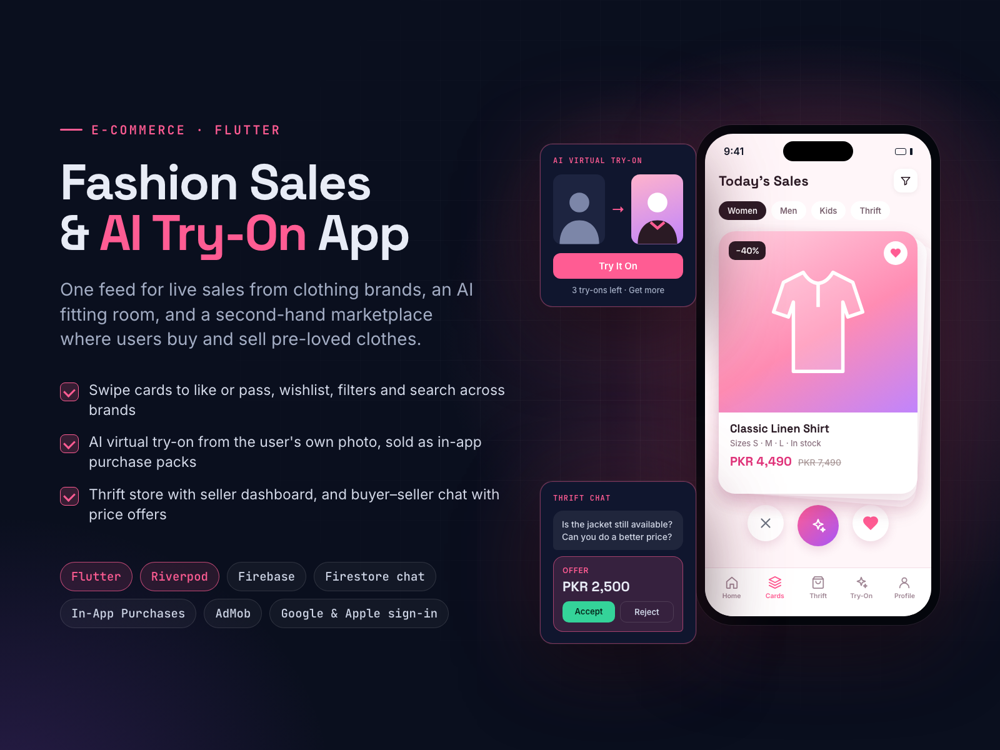

# Fashion Sales & AI Virtual Try-On App

**Flutter (iOS & Android)**

**Goal:** one app where shoppers see sales from many clothing brands, try outfits on and resell clothes.

**Solution:** a Flutter app with a sales feed, swipe cards, filters, search and a wishlist. Users upload a photo for AI virtual try-on, sold in packs through in-app purchases, plus rewarded and native ads. A thrift marketplace lets users list items with photos or video, run a seller dashboard and negotiate in a Firestore chat with price offers. Riverpod, go_router, Google and Apple sign-in.

**Result:** shopping, try-on and resale in one app, with two revenue streams (purchases and ads).

| | |
|---|---|
| **My role** | Lead Flutter developer (sole developer) |
| **Skills** | Flutter, Mobile App Development, Firebase, In-App Purchases, Chat & Messaging Software |

## About this repository

This is a showcase repository. It contains the project poster and the poster's own HTML/CSS source in [`poster/`](poster/).
The app was built for a client, so its source code and the client's name are not public.

To re-render the poster, open `poster/index.html` in Chrome at 1600×1200, or run `poster/render.sh` on macOS.

More of my work: **https://ahsanrazapk.github.io**
